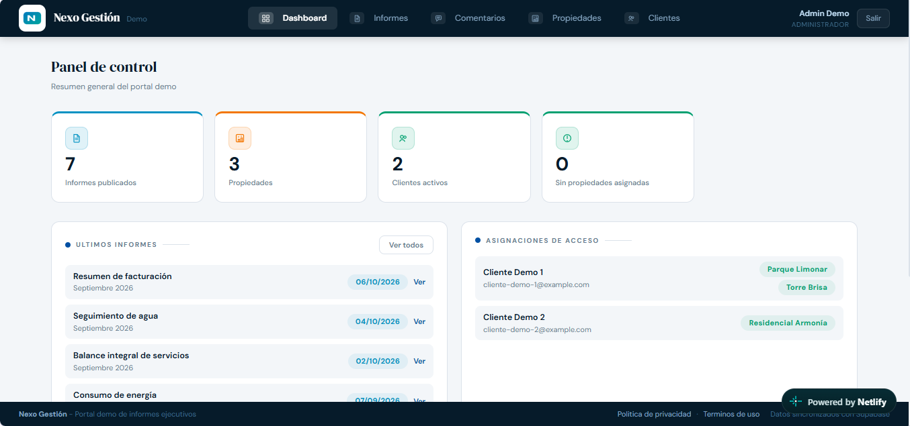
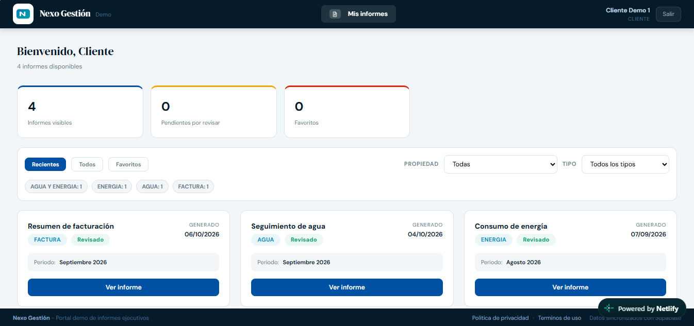

# Web de Informes

Portal web para **publicar, consultar y gestionar informes ejecutivos** dirigidos a clientes internos y externos. Un administrador carga y publica los informes; cada cliente accede únicamente a los de sus propiedades, puede comentarlos de forma privada y llevar el control de lo que ya revisó.

> Este repositorio es una **vitrina del proyecto**: describe qué hace la plataforma. No incluye el código fuente, los informes de clientes ni la configuración privada de la aplicación.

---

## ¿Qué problema resuelve?

Enviar informes por correo o en archivos sueltos dificulta el seguimiento: no hay un historial claro, las respuestas se pierden y cada cliente ve más (o menos) de lo que debería. Este portal centraliza todo en un solo lugar:

- Los informes se publican una vez y quedan disponibles en línea.
- Cada cliente ve solo lo que le corresponde.
- Las dudas y comentarios quedan asociados al informe, no dispersos en correos.

---

## Funcionalidades

### Para administradores

- **Gestión de propiedades y clientes:** crear propiedades, dar de alta clientes y asignarles las propiedades que pueden consultar.
- **Carga y publicación de informes:** subida individual o por lote, organización y publicación cuando estén listos.
- **Edición de comentarios dentro del informe**, con apoyo de un asistente con IA.
- **Conversación privada con cada cliente** sobre cada informe.
- **Panel administrativo** con resúmenes de actividad.
- **Ajuste de parámetros de facturación** de los informes.
- **Papelera y archivo histórico:** los informes retirados pasan primero a la papelera; al eliminarlos definitivamente se conserva una copia de respaldo para trazabilidad, sin que sigan visibles en el portal.

### Para clientes

- **Registro con verificación por correo** y recuperación o cambio de contraseña.
- **Acceso solo a los informes publicados de sus propiedades.**
- **Favoritos y marcado como revisado** para organizar su lectura.
- **Comentarios privados con el administrador** y notificaciones cuando hay respuestas.
- **Descarga e impresión** de informes.
- **Asistente con IA** para consultar el contenido de un informe.

---

## Cómo funciona

1. El administrador crea la propiedad y registra al cliente (o el cliente se registra y confirma su correo).
2. El administrador asigna al cliente las propiedades correspondientes.
3. Se suben y publican los informes.
4. El cliente inicia sesión, consulta sus informes, los marca y comenta lo que necesite.
5. El administrador responde en el mismo informe y ambos reciben notificaciones.

---

## Seguridad y privacidad

- Autenticación con roles diferenciados (administrador y cliente).
- Control de acceso a nivel de base de datos: cada usuario solo puede leer los datos que le corresponden.
- Cierre de sesión automático por inactividad.
- Las credenciales sensibles permanecen en el servidor y nunca se exponen en la aplicación del navegador.
- Los informes se cargan bajo demanda, no de forma masiva.

---

## Tecnologías

| Área                               | Herramienta           |
| ---------------------------------- | --------------------- |
| Interfaz                           | React 18              |
| Compilación y desarrollo           | JavaScript + Vite 7   |
| Autenticación y base de datos      | Supabase              |
| Funciones de servidor y despliegue | Netlify               |
| Soporte móvil (Android)            | Capacitor             |
| Entorno de desarrollo              | Node.js 20 o superior |

---

## Estado del proyecto

Versión **beta**, en uso y en evolución continua. Las funcionalidades descritas arriba están operativas; nuevas mejoras se incorporan de forma gradual.

---

## Vista de muestra

*Próximamente: capturas de pantalla de la vista del cliente y del panel administrativo, con datos de ejemplo.*

<!-- Cuando tengas capturas, guárdalas en una carpeta /docs y agrégalas así:

-->

---

## Sobre este repositorio

Este repositorio presenta el proyecto con fines informativos. El código fuente, los informes de clientes y la configuración privada **no** forman parte de él.

Para consultas sobre el proyecto, contacta a [@Milborne](https://github.com/Milborne).
